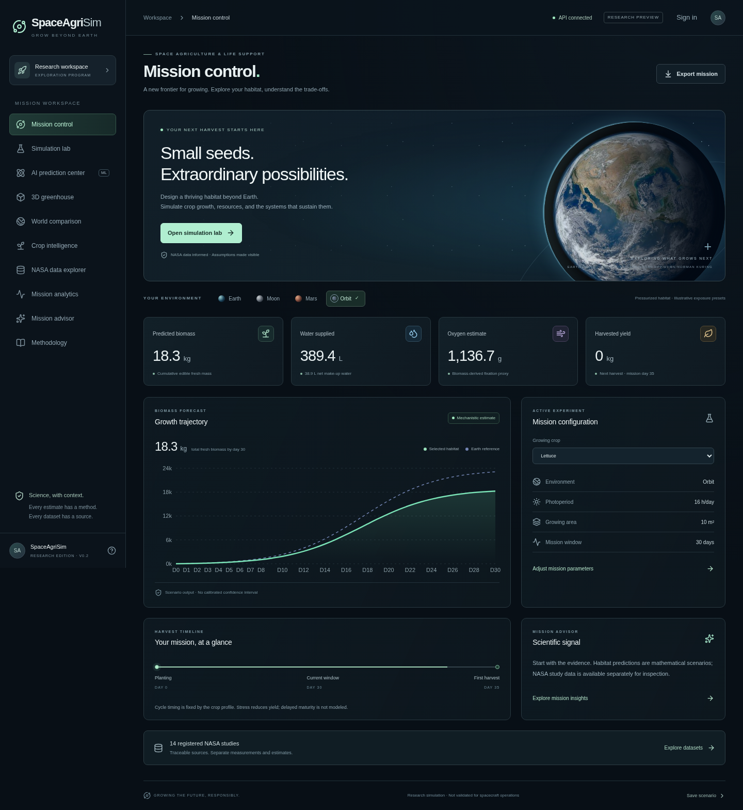

# SpaceAgriSim

SpaceAgriSim is an evidence-aware workspace for exploring controlled-environment crop scenarios for space habitats. It combines an explainable engineering simulator, a NASA OSDR catalogue and carefully scoped research models in one responsive web application.



## What is implemented

- Mission dashboard, advanced laboratory controls, Earth/Moon/Mars comparison, crop explorer, NASA study explorer, analytics, advisor and methodology views.
- A FastAPI simulation API with bounded inputs, request guards, deterministic reports and optional scenario history.
- A verified NASA OSDR inventory (25 NASA OSDR study records served: the 24-study provenance manifest plus the EDEN ISS analogue reviewed separately; 28 acquired files with checksums), provenance and data-quality views.
- Offline-only model training and versioned artifacts. The application never trains a model from a browser request.
- An Earth-only lettuce fresh-mass model trained on licensed WUR/4TU data, explicitly kept separate from NASA and spaceflight evidence.
- An interactive SVG growth chamber (orbit, zoom, per-system inspection) with a 2D schematic fallback, keyboard-accessible controls and responsive layouts. It is drawn with plain SVG, so no WebGL or 3D library ships in the bundle.

## Evidence boundaries

The simulator is an assumption-driven decision-support prototype, not a calibrated mission digital twin. NASA metadata and source files are preserved with provenance, but most registered studies do not provide a compatible crop-yield calibration target. The mizuna research model is deliberately marked weak (grouped CV MAE 15.50 g; R2 -0.333, worse than predicting the mean), and the tomato artifact classifies recorded molecular flight context rather than crop health, stress or yield. The lettuce model is Earth-only and does not support claims about partial gravity, radiation, water stress or other cultivars.

See [scientific validation](docs/SCIENTIFIC_VALIDATION.md), [model evaluation](docs/MODEL_EVALUATION.md), [model limitations](docs/MODEL_LIMITATIONS.md), and the [dataset gap analysis](docs/DATASET_GAP_ANALYSIS.md) before using any result.

## Run locally

Requirements: Python 3.12+ and Node 20+.

```powershell
python -m venv backend/.venv
backend/.venv/Scripts/python -m pip install -r backend/requirements.txt
backend/.venv/Scripts/python -m uvicorn app.main:app --app-dir backend --reload
```

In another terminal:

```powershell
cd frontend
npm install
npm run dev
```

Open `http://localhost:5173`. The Vite dev server proxies `/api` to the backend.

## Verify

```powershell
backend/.venv/Scripts/python -m pytest -q backend/tests
cd frontend
npm run lint
npm run typecheck
npm run test:unit     # jsdom: request lifecycles, hooks, error states
npm run build:check   # production build + bundle graph and size budget
npm run test:e2e      # Playwright: three viewports against the production build
```

The backend suite runs on SQLite by default; `SPACEAGRISIM_TEST_POSTGRES_URL` runs the same suite
against a real PostgreSQL server, where the PostgreSQL-only persistence tests execute instead of
skipping.

The current verification record — every gate, its exact command and its result — is
[docs/FINAL_PROJECT_COMPLETION_REPORT.md](docs/FINAL_PROJECT_COMPLETION_REPORT.md). Earlier phase
reports (for example [docs/TEST_REPORT.md](docs/TEST_REPORT.md) and
[docs/FINAL_QUALITY_GATES.md](docs/FINAL_QUALITY_GATES.md)) record the numbers measured at the time
they were written and are kept as history rather than updated. For container and hosted deployment,
see [docs/DEPLOYMENT.md](docs/DEPLOYMENT.md).

## Data and attribution

NASA study records point to their official OSDR sources; the product is not endorsed by NASA. The mission dashboard's Earth image is NASA/NOAA/GSFC/Suomi NPP/VIIRS imagery, credited in [frontend/public/assets/ATTRIBUTION.md](frontend/public/assets/ATTRIBUTION.md). The external lettuce data are CC-BY-4.0 and retain their source and license in the model card.

## Documentation

- [Final completion report](docs/FINAL_PROJECT_COMPLETION_REPORT.md)
- [Architecture](docs/ARCHITECTURE.md)
- [API documentation](docs/API_DOCUMENTATION.md)
- [NASA dataset inventory](docs/NASA_DATASET_INVENTORY.md)
- [Data provenance](docs/DATA_PROVENANCE.md)
- [ML training report](docs/ML_TRAINING_REPORT.md)
- [Implementation progress](docs/IMPLEMENTATION_PROGRESS.md)
- [Phase 7 final report — NASA scientific completion](docs/PHASE7_FINAL_REPORT.md)
- [NASA measurement catalog](docs/NASA_MEASUREMENT_CATALOG.md)
- [Phase 7 ML training](docs/PHASE7_ML_TRAINING.md) · [evaluation](docs/PHASE7_ML_EVALUATION.md)
- [Phase 7 scientific calibration](docs/PHASE7_SCIENTIFIC_CALIBRATION.md)
- [Phase 7 PostgreSQL verification](docs/PHASE7_POSTGRESQL_VERIFICATION.md)
- [Phase 12 final report — evidence-grounded AI](docs/PHASE12_FINAL_REPORT.md)
- [Phase 12 research assistant](docs/PHASE12_AI_RESEARCH_ASSISTANT.md) · [workflows](docs/PHASE12_AI_WORKFLOWS.md) · [dataset explorer](docs/PHASE12_DATASET_EXPLORER.md)
- [Phase 12 scientific dashboard](docs/PHASE12_SCIENTIFIC_DASHBOARD.md) · [simulator validation](docs/PHASE12_SIMULATOR_VALIDATION.md)
- [Phase 12 security review](docs/PHASE12_SECURITY_REVIEW.md) · [performance](docs/PHASE12_PERFORMANCE.md) · [competition demo](docs/PHASE12_COMPETITION_DEMO.md)
- [Phase 19 accounts, sharing and deployment readiness](docs/PHASE19_ACCOUNT_SHARING_READINESS.md)
- [Production readiness audit](docs/PRODUCTION_READINESS_AUDIT.md) · [database backup and recovery](docs/DATABASE_BACKUP_AND_RECOVERY.md) · [backup automation setup](docs/DATABASE_BACKUP_AUTOMATION.md) · [why the API runs one worker](docs/MULTI_WORKER_RATE_LIMITING.md)
- [Phase 35 final report — completion and evidence verdicts](docs/PHASE35_REPORT.md) · [scientific validation](docs/PHASE35_SCIENTIFIC_VALIDATION.md) · [data acquisition](docs/PHASE35_DATA_ACQUISITION.md)
- [Phase 35 security audit](docs/PHASE35_SECURITY_AUDIT.md) · [performance](docs/PHASE35_PERFORMANCE_REPORT.md) · [accessibility](docs/PHASE35_ACCESSIBILITY_REPORT.md) · [visual regression](docs/PHASE35_VISUAL_REGRESSION.md)
- [Final delivery report](docs/FINAL_DELIVERY_REPORT.md) · [audit findings](docs/FINAL_AUDIT_FINDINGS.md) · [quality gates](docs/FINAL_QUALITY_GATES.md) · [changelog](docs/FINAL_CHANGELOG.md)
- [Final scientific evidence](docs/FINAL_SCIENTIFIC_EVIDENCE.md) · [limitations](docs/FINAL_LIMITATIONS.md) · [security review](docs/FINAL_SECURITY_REVIEW.md) · [operations](docs/FINAL_OPERATIONS.md) · [frontend](docs/FINAL_FRONTEND_REPORT.md)
